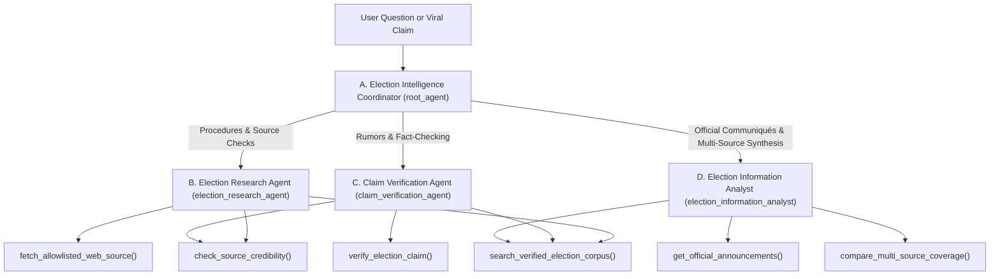

# Architecture Overview: Trustworthy Multi-Agent Election Intelligence with Google ADK

## 1. Executive Summary
The **DevFest Lagos 2026 Election Intelligence Agent** is a multi-agent system built with **Google's Agent Development Kit (`google-adk`)** and engineered inside the **Antigravity Harness**. It addresses the critical problem of election misinformation by enforcing a strict architectural separation between **information retrieval**, **source credibility assessment**, **evidentiary claim verification**, and **multi-source synthesis**.

---

## 2. Multi-Agent Topology (`google-adk`)

### Agent Responsibilities

| Agent Name | Role in Hierarchy | Primary Responsibility | Registered ADK Function Tools |
|---|---|---|---|
| `election_intelligence_coordinator` (`root_agent`) | Root Orchestrator | Understands user intent, delegates to the appropriate specialist sub-agent, synthesizes findings, and attaches explicit epistemic status badges (`SUPPORTED`, `CONTRADICTED`, `INSUFFICIENT_EVIDENCE`). | `search_verified_election_corpus`, `verify_election_claim`, `get_official_announcements`, `compare_multi_source_coverage`, `check_source_credibility` |
| `election_research_agent` | Specialist Sub-Agent | Searches the verified corpus of INEC guidelines and Electoral Act provisions, validates domain allowlists, and blocks untrusted URLs. | `search_verified_election_corpus`, `check_source_credibility`, `fetch_allowlisted_web_source` |
| `claim_verification_agent` | Specialist Sub-Agent | Evaluates user-submitted claims against retrieved evidence, distinguishing source authority from evidentiary truth. | `verify_election_claim`, `search_verified_election_corpus`, `check_source_credibility` |
| `election_information_analyst` | Specialist Sub-Agent | Summarizes official Electoral Commission announcements, extracts statutory dates, and compares Tier 1, Tier 2, and Tier 3 sources. | `get_official_announcements`, `compare_multi_source_coverage`, `search_verified_election_corpus` |

---

## 3. Why Retrieval ≠ Verification

A standard Retrieval-Augmented Generation (RAG) chatbot retrieves text chunks based on keyword or vector similarity. In an election context, if an official INEC press release states:
> *"The Commission refutes viral rumors claiming the November 21 election was postponed to December 12..."*

A naive retriever matches *"postponed to December 12"*, and an unguarded generator may summarize the rumor ambiguously. Our architecture solves this at three levels:
1. **Three-Tier Source Trust Registry (`data/trusted_sources.json`):** Every source is explicitly scored (`TIER_1_OFFICIAL = 0.98`, `TIER_2_ACCREDITED_OBSERVER = 0.90`, `TIER_3_VERIFIED_MEDIA = 0.78`, `UNTRUSTED = 0.00`).
2. **Dedicated Verification Tooling (`verify_election_claim`):** Evaluates whether retrieved Tier 1 and Tier 2 records **confirm**, **refute**, or **lack sufficient evidence** for the claim.
3. **Epistemic Humility Guardrails:** When field verification is still ongoing (e.g., `[YIAGA-2026-INC-09]` regarding alleged polling unit relocations in Eti-Osa and Alimosho), the agent outputs `INSUFFICIENT_EVIDENCE` rather than speculating.
